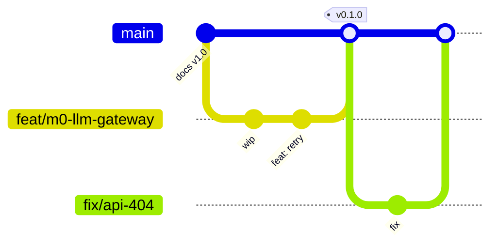

# 00 · 分支管理与开发工作流规范

> 文档版本：v1.0（2026-10-25）
> 适用对象：本项目所有参与者——人类 owner 与所有参与开发/文档/CI 的 AI agent。
> 定位：**git 分支、提交、PR、推送的唯一规范**。与 [07 §6 工程纪律](07-roadmap.md)（代码质量纪律）并行生效；涉及分支/推送/合并的事项以本文档为准。
> 修订规则：面向个人项目的放宽条款**已内置在本文档中**（见 §9），不得在现场自行再放宽；流程需要变更时，先提 PR 修订本文档，再按新规执行。

---

## 1. 分支模型：trunk-based 单主干（简化版 GitHub Flow）

参照 Google / 字节等主流「主干开发」实践，按个人项目裁剪：



- **`main` 是唯一长期分支**：随时可构建、测试通过；只接受 PR 合入，不接受直推；
- **不设** `develop` / `release` / `hotfix` 常驻分支：个人项目无多版本并行，常驻分支的同步成本大于收益。修复 = 从 main 切 `fix/` 分支，发布 = 在 main 打 tag；
- **特性分支短生命周期**：与 trunk-based 最佳实践一致，目标数天内合回 main，避免长期分支漂移（上限见 §8 红线 7）；
- **历史线性**：main 只接受 squash merge，不允许 merge commit 进入 main。

**三条铁律**（任何 agent 在任何情况下不得违反）：

1. 不直推 `main`；
2. 不 force push / rebase 已推送的分支（`exp/*` 实验分支除外）；
3. 不向本仓库以外的任何远端推送——尤其 `zingaltern/openai-code-review` 原仓库，**永久禁止**。

## 2. 分支命名

格式：`<type>/<slug>`

| type | 用途 | 示例 |
|---|---|---|
| `feat` | 新功能 / 新模块 | `feat/m0-llm-gateway` |
| `fix` | 缺陷修复 | `fix/compare-api-404-fallback` |
| `docs` | 仅文档改动 | `docs/revise-v1.1-blind-review` |
| `refactor` | 不改行为的重构 | `refactor/trace-event-model` |
| `test` | 仅测试 | `test/wiremock-fixtures` |
| `chore` | 构建 / 工具 / 依赖 / CI | `chore/ci-workflow` |
| `perf` | 性能优化 | `perf/context-trim` |
| `exp` | 一次性实验，可丢弃；唯一允许 force push 的类型 | `exp/prompt-variant-b` |

- slug 用小写英文 + kebab-case，**不用中文**（shell 转义与 CI 工具兼容性）；
- 建议带里程碑前缀 `m<N>-`（如 `feat/m1-finding-schema`），便于归档回溯；
- **一个任务一个分支**；分支名与实际改动不符时，删掉重建，而不是将错就错。

## 3. 提交规范（Conventional Commits）

格式：`<type>: <主题>`，type 同 §2 表；主题用中文、一行说清（≤50 字），正文可选、解释「为什么」。与本仓库既有提交风格一致：

```
docs: 技术方案 v1.0 —— 需求调研、总体架构、多子代理隔离评审与盲评验证设计
feat: cra-llm 网关超时重试与 token 计数落 trace
fix: compare API 404 时回退为单 commit diff
```

- **原子提交**：一次提交只做一件事，禁止「顺手」混入无关改动；
- 禁止空信息或无意义信息（`update`、`fix bug`、`1`）；
- 不提交密钥 / `.env` / token / 大体积生成物（M0 建 `.gitignore` 时统一覆盖）。

## 4. 标准工作流（六步）

```bash
# 1. 从最新 main 切分支
git switch main && git pull --ff-only
git switch -c feat/m0-llm-gateway

# 2. 小步提交（每完成一个可验证的小块就 commit）
git add -A && git commit -m "feat: …"

# 3. 开发期间 main 有更新时，合入同步（不要 rebase）
git fetch origin && git merge origin/main

# 4. 完成后本地自检——M0 起为 mvn -B -ntp verify；纯文档改动为交叉引用/编号检查
mvn -B -ntp verify

# 5. 推送并创建 PR
git push -u origin feat/m0-llm-gateway
gh pr create --title "feat: …" --body "…"

# 6. squash 合并后清理分支（本地 + 远端）
git switch main && git pull --ff-only
git branch -d feat/m0-llm-gateway
git push origin --delete feat/m0-llm-gateway
```

## 5. PR 规范与合并策略

**PR 描述三行模板**（不做大厂多段模板）：

```
改了什么：
为什么：
怎么验证的：（粘贴构建/测试输出摘要——agent 必须附真实输出，禁止编造）
```

- 合并方式：**Squash and merge**，PR 标题即成为 main 上的 commit；
- 合并条件：① 本地自检通过；② 与最新 main 无冲突；③ PR 描述完整；
- 默认由 owner 合并；owner 明确授权后 agent 可自行合并（单人项目放宽，免审批）；
- 合并后**立即删除**功能分支（本地 + 远端），并在 GitHub 开启 auto-delete；
- 不强制关联 issue；建议在 PR 描述中注明所属里程碑（如 `M0`）。

## 6. 同步与冲突处理

- 同步方向固定：把 `origin/main` **merge 进**功能分支；禁止 rebase 已推送分支（改写历史在 agent 协作下风险远大于收益）；
- 冲突在功能分支解决后提交 `chore: sync main`；
- PR 页面出现冲突时同样本地解决后 push，不在 GitHub 网页端解决。

## 7. 版本与里程碑

- tag 只打在 main，格式 `v0.<里程碑序号>.<补丁号>`：M0 完成 → `v0.1.0`，M1 → `v0.2.0`，以此类推；
- 里程碑完成的定义以 [07 路线图](07-roadmap.md) 各节验收标准为准；
- 打 tag 前确认 main 为绿（CI 通过）；tag 由 owner 打，或 owner 授权后 agent 打。

## 8. Agent 红线（硬约束清单）

对**所有开发 agent** 生效，违反任何一条按事故处理：

**Git / 远端操作**
1. 不直推 `main`，一切改动走分支 + PR；
2. 不 force push、不 rebase 已推送分支（`exp/*` 除外）；
3. 不向本仓库以外任何远端推送——**尤其严禁向 `zingaltern/openai-code-review` 推送任何内容**；
4. 未经 owner 明确指示：不添加 / 删除 / 改名 remote，不改 GitHub 仓库设置与分支保护规则，不删除非自己创建的分支；
5. push 前先 `git fetch`，确认远端无新提交再推；遇到非快进推送（远端有分叉）说明分支状态异常，停下来报告，不强行覆盖。

**分支与提交**
6. 一个任务一个分支，从最新 main 切出，命名符合 §2；
7. 分支合并后立即删除；`feat`/`fix` 分支超过 1 周未合并时，主动向 owner 报告并评估收窄范围或重建，而不是继续堆提交；
8. 提交原子、信息真实；不提交密钥 / 凭据 / 生成物；
9. 自检（构建 + 测试）不通过不得发起 PR；PR 中的验证证据必须真实粘贴输出，禁止无输出地声称「已验证」。

**协作边界**
10. 只在自己创建（或 owner 明确指定）的分支上提交，不修改其他 agent 正在使用的分支；
11. 当流程规则与开发效率冲突时，不得自行放宽，先向 owner 提议修订本文档。

## 9. 大厂流程 → 本项目取舍对照

本节是「哪些大厂流程被保留、哪些被放宽/省略」的权威清单：

| 大厂实践 | 本项目 | 理由 |
|---|---|---|
| trunk-based 主干开发（Google / 字节主流） | ✅ 保留 | 即本模型 |
| 短生命周期分支（≤1 天） | ✅ 保留，放宽至 ≤1 周 | agent 按会话/任务开发，任务粒度即分支粒度 |
| 阻塞式代码评审（≥1–2 approver） | ⬇️ 放宽：agent 自验证 + owner 抽查 | 无团队可互审；自验证证据强制写入 PR 弥补 |
| CODEOWNERS 强制指定评审人 | ✂️ 省略 | 单人项目无意义 |
| 强制关联 issue / Jira、评审 SLA | ✂️ 省略 | 建议 PR 注明里程碑即可 |
| CI 多门禁（lint / e2e / 安全扫描 / 覆盖率阈值） | ⬇️ 渐进：M0 仅 `mvn verify`，后续按里程碑加码 | 代码尚不存在；门禁随 07 各 M 验收标准逐步引入 |
| GitFlow 的 develop / release / hotfix 常驻分支 | ✂️ 省略 | 无多版本并行维护需求 |
| 发布火车 / 冻结期 | ✂️ 省略 | main 打 tag 即发布 |
| 多段式 PR 模板 | ⬇️ 三行模板 | 效率优先 |
| merge / rebase 策略之争 | ✅ 定死 squash merge | main 线性历史，agent 零歧义 |

## 10. 仓库一次性配置清单（仅 owner 执行，agent 不操作）

- [ ] Settings → General → Pull Requests：只勾选 **Squash merge**；勾选 **Automatically delete head branches**
- [ ] Settings → Branches → `main` 保护规则：Require a pull request before merging；CI 就绪后追加 Require status checks（`mvn verify`）；**Block force pushes**；Require linear history
- [ ] M0 起添加 `.github/workflows/ci.yml`（执行 `mvn -B -ntp verify`）并设为 required status check
- [ ] 本地关联远端（如尚未配置）：`git remote add origin git@github.com:zingaltern/code-review-agent.git`

## 11. 速查表

| 场景 | 动作 |
|---|---|
| 开始新任务 | `git switch main && git pull --ff-only && git switch -c <type>/<slug>` |
| 提交 | `git commit -m "<type>: <中文主题>"`，小步原子 |
| main 有更新 | `git fetch origin && git merge origin/main`，冲突解决后 `chore: sync main` |
| 完成自检 | `mvn -B -ntp verify`（M0 前：文档交叉引用检查） |
| 推送 / 建 PR | `git push -u origin <branch>` → `gh pr create` |
| 合并后 | 删本地 + 远端分支 |
| 修复线上问题 | 从 main 切 `fix/`，流程同上（无单独 hotfix 流程） |
| 里程碑完成 | main 为绿后打 tag `v0.<M>.0` |
| 一次性实验 | `exp/<slug>` 分支随便造，唯一允许 force push，可随时丢弃 |
